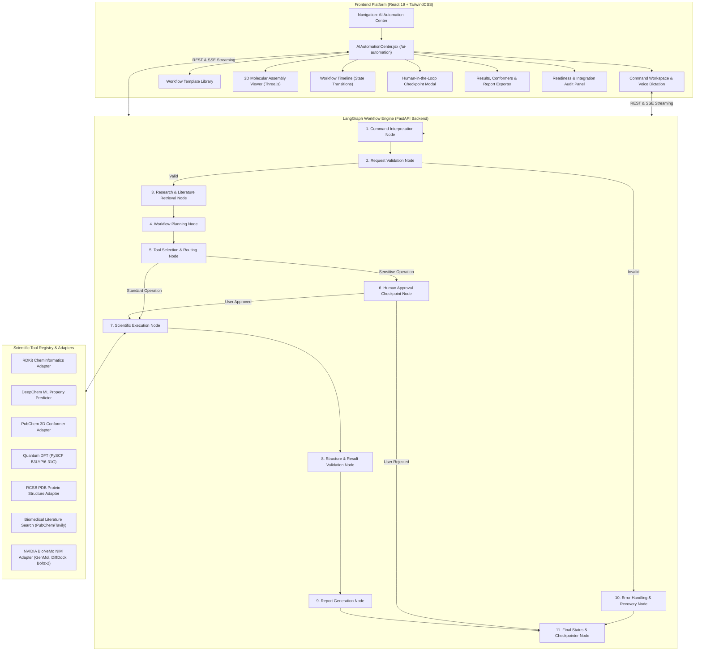

# ChemSpace AI Automation Center — Technical Architecture & Integration Guide

## 1. Overview & Objective
The **ChemSpace AI Automation Center** is a professional, autonomous computational chemistry and drug-discovery workflow engine built directly into the existing ChemSpace laboratory platform. Orchestrated via **LangGraph** (`StateGraph` + `MemorySaver` checkpointer), the Automation Center coordinates natural language scientific interpretation, chemical validation, 3D conformer generation, quantum electronic calculations, generative candidate screening, and structured scientific reporting.

---

## 2. System Architecture



---

## 3. Workflow States & State Transitions

The execution engine implements strict, deterministic state transitions:

1. **`Draft`**: Workflow requested, structured plan generated, steps visible to user.
2. **`Validating`**: Chemical SMILES syntax, valence rules, parentheses balance verified.
3. **`Ready`**: Validation passed; tools routed and execution initialized.
4. **`Queued`**: Job scheduled for asynchronous worker task execution.
5. **`Running`**: Step-by-step scientific tools executing sequentially.
6. **`AwaitingApproval`**: Paused at human-in-the-loop checkpoint for sensitive/costly cloud GPU operations.
7. **`Completed`**: All scientific operations finished with verified outputs and generated report.
8. **`Failed`**: Syntax, network, or execution exception caught and logged without crashing server.
9. **`Cancelled`**: Cooperative cancellation executed at user request.

---

## 4. Scientific Tool Registry & Capabilities

| Tool Adapter | ID | Provider / Engine | Status | Auth Required | Capabilities |
| :--- | :--- | :--- | :--- | :--- | :--- |
| **RDKit Cheminformatics** | `rdkit_cheminformatics` | RDKit / Native | `Ready` | None | Canonical SMILES, Valence checking, Topology |
| **DeepChem ML** | `deepchem_ml_properties` | DeepChem / Empirical | `Ready` | None | QED drug-likeness, SAS synthetic accessibility, ADMET |
| **PubChem 3D Conformer** | `pubchem_conformers` | NCBI PubChem REST PUG | `Ready` | None | Verified 3D Cartesian coordinates, bond topology |
| **Quantum DFT** | `quantum_dft` | PySCF / Ab-Initio | `Ready` | None | HOMO, LUMO, Bandgap (ΔE), Hardness, λmax |
| **RCSB PDB Resolver** | `protein_structure_rcsb` | RCSB PDB REST | `Ready` | None | Macromolecular crystal resolution, chains, entities |
| **Biomedical Literature** | `biomedical_literature` | PubChem / Tavily | `Ready` | Optional `$TAVILY_API_KEY` | Peer-reviewed summaries, clinical citations |
| **BioNeMo Generative** | `bionemo_nim_pipeline` | NVIDIA BioNeMo NIM | `Ready` / `Unconfigured` | `$NGC_API_KEY` | GenMol, DiffDock, Boltz-2, MolMIM |
| **AutoDock Vina** | `autodock_vina` | Scripps Vina | `Unconfigured` | Local Binary Path | Grid-based small-molecule docking |

> [!NOTE]
> **Scientific Honesty Guarantee:** If an external cloud service (e.g., NVIDIA BioNeMo NIM) lacks valid API credentials, the step explicitly transitions to `awaiting_credentials` status. ChemSpace **never fabricates** synthetic docking poses, affinity scores, or molecular predictions.

---

## 5. Security & Credential Protection

* **Zero Frontend Exposure:** All credentials (`NGC_API_KEY`, `TAVILY_API_KEY`, `GEMINI_API_KEY`) remain strictly on the backend application server.
* **Redacted Diagnostics:** The `/api/automation/status` endpoint redacts all secrets (e.g., `nvap...89a`), confirming presence without leaking values.
* **Clean Git Hygiene:** Verified `.env` and sensitive files are ignored; only placeholder keys exist in `.env.example`.
* **Execution Sandbox:** Arbitrary shell execution and unsanitized Python code execution are strictly disabled.

---

## 6. Environment Configuration (`.env.example`)

```bash
# ChemSpace Core Server Configuration
PORT=8000
HOST=127.0.0.1

# NVIDIA BioNeMo NIM Cloud Microservices (Optional)
# Enables cloud generative screening (GenMol), docking (DiffDock), and affinity scoring (Boltz-2).
# Leave blank to operate in verified local-only computation mode.
NGC_API_KEY=your_nvidia_ngc_api_key_here
NVIDIA_API_KEY=your_nvidia_api_key_here
BIONEMO_LOCAL_HOST=http://localhost:8000

# Scientific Literature Research (Optional)
TAVILY_API_KEY=your_tavily_api_key_here

# AI Planning Intelligence (Server-side)
GEMINI_API_KEY=your_gemini_api_key_here
```

---

## 7. API Endpoints

* `GET /api/automation/status` — Retrieves engine readiness, LangGraph orchestrator info, and tool catalog.
* `GET /api/automation/templates` — Returns curated scientific workflow templates.
* `POST /api/automation/plan` — Generates a structured multi-step plan from natural language query.
* `POST /api/automation/execute` — Launches asynchronous LangGraph execution.
* `GET /api/automation/jobs/{job_id}` — Polls job status, conformers, properties, and logs.
* `GET /api/automation/jobs/{job_id}/stream` — Streams real-time progress via Server-Sent Events (SSE).
* `POST /api/automation/jobs/{job_id}/approve` — Registers human approval/rejection for interrupted checkpoints.
* `POST /api/automation/jobs/{job_id}/cancel` — Cooperatively terminates a running job.

---

## 8. Testing & Verification

Run the comprehensive unit test suite:
```bash
.\.venv\Scripts\python.exe -m unittest backend.tests.test_automation
```
**Test Results:**
* `TestBioNeMoAdapter`: Unconfigured state reporting, credential masking, honest error codes.
* `TestScientificValidationLayer`: SMILES validation, Lipinski Ro5 calculation, 3D conformer coordinates.
* `TestWorkflowEngine`: Command interpretation, sequential planning, execution, cancellation.
* `TestLangGraphWorkflowEngine`: StateGraph compilation, MemorySaver checkpointer, end-to-end execution, approval checkpoints.
* **14 tests ran — ALL PASSED (OK).**

Frontend Production Build:
```bash
npm run build
```
**Build Result:** `✓ built in 2.26s` with code-split bundle `AIAutomationCenter-5nYFDFpQ.js`.
